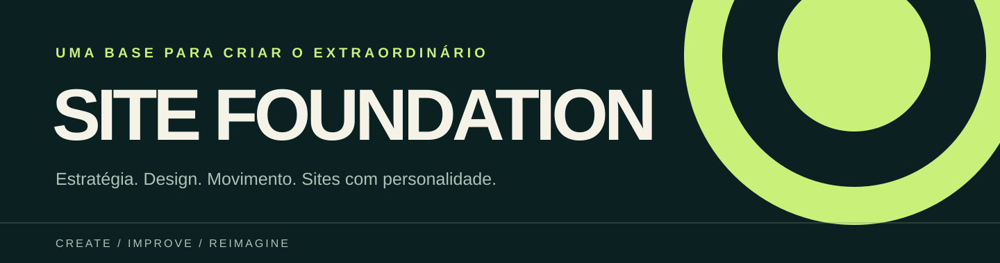
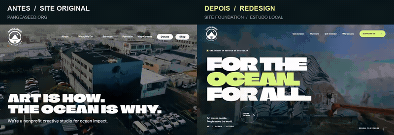

<p align="center"></p>

<h1 align="center">Ideias fortes merecem sites à altura.</h1>

<p align="center"><strong>Uma base aberta para transformar referências em experiências digitais com propósito e personalidade.</strong></p>

<p align="center"><a href="#em-cena--pangeaseed">Ver antes e depois</a> · <a href="design-references.md">Explorar referências</a> · <a href="regme.md">Conhecer a base</a></p>

## Em cena — PangeaSeed

Uma exploração de redesign da página inicial: o site original à esquerda e a proposta local à direita. A gravação mostra as duas páginas em navegação, incluindo trechos da rolagem. O redesign usa vídeo da própria PangeaSeed, uma nova composição editorial e movimento para dar ritmo à experiência.

[](assets/showcase/pangeaseed-before-after.mp4?raw=1)

**[↓ Baixar o vídeo completo em MP4](assets/showcase/pangeaseed-before-after.mp4?raw=1)** · [Visitar o site original](https://pangeaseed.org/)

> Estudo local de design, não afiliado à PangeaSeed. A identidade e os conteúdos mostrados pertencem aos respectivos titulares. O redesign e os textos são propostas, não representam aprovação da organização. Os direitos de redistribuição das mídias não foram verificados.

## Uma base. Muitas possibilidades.

Base reutilizável para planejar, criar, melhorar e clonar sites com apoio de IA. Reúne especificações de sites e páginas, requisitos de qualidade, um fluxo de entrada progressivo, orientações de mídia e publicação, além do código-fonte oficial do shadcn/ui como repertório comum de componentes.

O objetivo é começar novos projetos com critérios claros e referências verificáveis, mantendo uma base compartilhada que possa crescer sem ser reescrita a cada tipo de site.

**O ponto de partida é este README. O índice principal das especificações continua sendo [regme.md](regme.md).**

> Esta base contém documentação, código de terceiros e adaptadores de orientação para agentes. Ela não é um gerador automático de sites, uma aplicação pronta para executar ou um mecanismo universal de deploy.

## Referências que alimentam o processo

[Awwwards](https://www.awwwards.com/) · [CSS Design Awards](https://www.cssdesignawards.com/) · [SiteInspire](https://www.siteinspire.com/) · [The FWA](https://thefwa.com/)

O [guia de referências](design-references.md) explica como pesquisar, selecionar e traduzir ideias para cada projeto com evidências e critérios. O [motor criativo](creative-engine.md) organiza o trabalho de arquitetura, design, copy, construção e revisão. Galerias inspiram; não substituem uma direção escolhida nem a validação do resultado.

## O que você encontra aqui

| Parte | Conteúdo | Onde consultar |
|---|---|---|
| Biblioteca de sites | 22 especificações de tipos de site, com propósito, entradas, critérios e pendências | [Tipos de site](tippus/site-types/) |
| Biblioteca de páginas | 44 especificações de páginas e fluxos, combináveis conforme o projeto | [Modelos de página](tippus/pages/) |
| Requisitos compartilhados | Acessibilidade, conteúdo, responsividade, mídia, desempenho, movimento e revisão | [Requisitos comuns](common-requirements.md) |
| SEO e leitura por máquinas | Metadados, indexação, arquivos técnicos e informações acessíveis a buscadores e IA | [Checklist técnico](technical-seo.md) |
| Imagens e vídeos | Decisão de ferramentas, permissões, amostras, integração e verificação | [Fluxo de mídia](media-workflow.md) |
| Operações de site | Processos próprios para criação, melhoria e clonagem | [Fluxos de trabalho](site-workflows.md) |
| Entrada com IA | Skill comum e adaptadores para Codex, Claude Code, Antigravity e OpenCode v1 | [Skill site-intake](.agents/skills/site-intake/SKILL.md) |
| Componentes | Código-fonte oficial do shadcn/ui, com sua licença e organização original | [Repertório shadcn/ui](shadcn-ui/) |
| Preparação de publicação | Entradas, pré-requisitos, saídas e pendências dos alvos documentados | [Publicação e deploy](regme.md#preparação-de-publicação-e-repertório-de-componentes) |

As quantidades acima descrevem os arquivos presentes na biblioteca. Não significam 66 sites implementados nem 66 modelos visuais prontos.

## Para que usar

A mesma fundação atende três operações:

- **Criar:** partir de objetivo, conteúdo e referência visual para definir a composição e implementar o escopo aprovado.
- **Melhorar:** examinar um site existente, registrar os problemas e alterar as partes confirmadas, preservando o restante.
- **Clonar:** reproduzir a aparência e/ou o comportamento autorizado de uma referência, dentro do escopo e dos direitos de uso confirmados.

As especificações incluem, por exemplo, sites institucionais, portfólios, landing pages, comércio eletrônico, catálogos, blogs, eventos, áreas de membros e documentação. A presença desses tipos não instala suas funcionalidades: cada projeto define o que realmente precisa implementar.

Para páginas comerciais e de organização, há modelos de [página de vendas](tippus/pages/sales-page.md), [upsell](tippus/pages/upsell.md), [proposta comercial](tippus/pages/business-proposal.md) e [solicitação de orçamento](tippus/pages/quote.md). O catálogo completo está no [índice principal](regme.md).

## Como começar

### 1. Disponibilize a base

Clone o repositório ou obtenha uma cópia de seus arquivos. Para trabalhar com os adaptadores, abra a raiz que contém este README no ambiente de IA escolhido.

Não existe um `package.json` de aplicação na raiz nem um comando único de instalação, desenvolvimento ou build desta fundação. Esses comandos serão definidos pelo projeto concreto.

Os hooks de comando documentados para Codex, Claude Code e Antigravity usam Node.js. O reconhecimento de hooks, regras e skills precisa ser conferido no ambiente utilizado.

### 2. Informe o trabalho que deseja realizar

Você pode começar sem ter todas as respostas. O agente deve reaproveitar as informações já fornecidas e perguntar apenas o que estiver faltando.

**Exemplo ilustrativo de solicitação:**

> Quero criar uma landing page para uma oferta. Minha referência visual está no arquivo indicado e meus textos estão nesta pasta. Ainda não tenho design system. Primeiro organize as entradas, identifique as lacunas e apresente a direção visual para aprovação.

Esse exemplo não define uma oferta, uma tecnologia ou um conjunto obrigatório de páginas.

### 3. Passe pela entrada progressiva

A [skill site-intake](.agents/skills/site-intake/SKILL.md) orienta o agente a confirmar:

1. Se o pedido é de criação, melhoria ou clonagem, qual o tipo de site, o objetivo e o público.
2. Quais fontes serão usadas e onde estão: briefing, textos, arquivos, site existente ou outros materiais disponíveis.
3. Qual é a referência visual e o que deve ser preservado, transformado ou reproduzido.
4. Se existe design system adequado e em qual pasta estão seus materiais.
5. Se já existe um `design.md` extraído das referências e onde está.
6. Quais páginas, conteúdos, comportamentos, restrições e aprovações são indispensáveis para a próxima etapa.
7. Quais acessos, ferramentas e autorizações serão necessários quando a etapa depender deles.

**A referência visual é obrigatória para desenvolver o site.** Pode ser uma imagem, storyboard, simulação ou desenvolvimento prévio que permita avaliar a aparência. Texto sozinho não substitui essa etapa.

O desenvolvimento prévio é opcional. Se a pessoa não tiver referência, o agente deve oferecer essa possibilidade e confirmar seu escopo antes de produzi-la. A referência resultante precisa ser aceita antes da implementação visual.

Uma informação incompleta bloqueia a parte que depende dela. O agente registra a pendência, confirma a decisão com a pessoa e pode continuar apenas o trabalho independente.

### 4. Consolide a direção e selecione as especificações

O `design.md` do projeto registra a direção extraída das referências. O design system associado complementa essas decisões quando existe e é adequado.

Sem design system, é necessário levantar as orientações disponíveis de identidade, cores, tipografia, espaçamento, aparência e comportamento dos elementos. O que não foi fornecido deve ser tratado como proposta ou pendência e confirmado antes de ser aplicado.

Depois, selecione as especificações pertinentes em `tippus/site-types/` e `tippus/pages/`. Combine os requisitos específicos com os documentos comuns. Um checklist da biblioteca é ponto de partida para confirmar escopo, não autorização para adicionar todas as suas possibilidades.

### 5. Implemente, revise e entregue com evidência

Com a direção e as entradas necessárias confirmadas, componha o site usando a base comum de componentes, integre o conteúdo e a mídia autorizados e execute verificações proporcionais ao que foi implementado.

Registre separadamente:

- O que foi implementado.
- O que foi efetivamente verificado e com qual evidência.
- O que depende de aprovação ou ainda não foi testado.

Build, lint ou conferência documental não substituem revisão visual, teste de navegação e aprovação da pessoa. Publicação é uma etapa própria, dependente de autorização e configuração do destino.

## Estrutura do repositório

```text
.
├── README.md                    # Apresentação e início de uso
├── regme.md                     # Índice principal, entradas e publicação
├── AGENTS.md                    # Orientações para agentes
├── CLAUDE.md                    # Entrada das orientações para Claude
├── common-requirements.md       # Critérios compartilhados de qualidade
├── technical-seo.md             # SEO, metadados e leitura por máquinas
├── media-workflow.md            # Imagem, vídeo e alternativa pelo Flow
├── site-workflows.md            # Criação, melhoria e clonagem
├── tippus/
│   ├── site-types/              # 22 tipos de site
│   └── pages/                   # 44 modelos de página
├── .agents/
│   ├── hooks.json               # Adaptador de entrada para Antigravity
│   ├── rules/site-intake.md     # Regra de entrada
│   └── skills/site-intake/      # Skill comum
├── .claude/
│   ├── settings.json            # Hook de entrada para Claude Code
│   └── skills/site-intake/      # Cópia da skill para Claude
├── .codex/hooks.json            # Hook de entrada para Codex
├── .opencode/plugins/
│   └── site-intake.js           # Adaptador OpenCode v1
└── shadcn-ui/                   # Fonte oficial e licença de terceiros
```

Os nomes de arquivos e pastas são mantidos em inglês. `regme.md` e `tippus` são os nomes já adotados para o índice e a biblioteca.

## Base comum de componentes: shadcn/ui

O [shadcn/ui](https://ui.shadcn.com/) é a base estrutural comum definida para os componentes. Cada site combina e adapta esse repertório ao design aprovado, sem criar uma biblioteca independente para cada tipo de site.

O repositório oficial está incorporado em [shadcn-ui/](shadcn-ui/), incluindo seus arquivos rastreados e sua [licença MIT](shadcn-ui/LICENSE.md). A revisão de origem registrada nesta base é:

```text
96da9cc7f1aa10580a3741664e2a77c721206c00
```

Ter o código-fonte disponível não significa ter todos os componentes instalados ou integrados a uma aplicação. A seleção, as dependências e a adaptação são verificadas no projeto que será construído. Não execute automaticamente as instalações, scripts ou automações do repositório de terceiros.

## Uso nos ambientes de IA

| Ambiente | Entradas presentes na base | O que conferir na sessão |
|---|---|---|
| Codex | `AGENTS.md`, `.agents/skills/site-intake/` e `.codex/hooks.json` | Descoberta da skill, reconhecimento e ativação do hook |
| Claude Code | `CLAUDE.md`, `.claude/settings.json` e `.claude/skills/site-intake/` | Carregamento das instruções, skill e hook |
| Antigravity | `.agents/hooks.json`, `.agents/rules/site-intake.md` e skill comum | Reconhecimento das personalizações e execução do hook |
| OpenCode v1 | `AGENTS.md` e `.opencode/plugins/site-intake.js` | Versão compatível e carregamento do plugin |

Os adaptadores acrescentam instruções ao contexto do agente. Eles não constituem uma trava técnica que impeça todas as execuções nem comprovam que o agente seguirá a sequência corretamente.

A documentação registra verificações isoladas das configurações e dos adaptadores. O funcionamento completo em sessões reais dos quatro ambientes permanece pendente. OpenCode v2 não tem adaptador implementado nesta base.

Para conferir a entrada em um ambiente real, peça um site sem referência visual e observe se o agente solicita os dados necessários antes de implementar. Depois forneça a referência e verifique a retomada. Um pedido exclusivamente documental não deve disparar esse bloqueio de desenvolvimento.

## Imagens, vídeos e Flow

O projeto deve considerar mídia quando ela contribuir para o conteúdo e a experiência. Primeiro inventarie os materiais existentes e autorizados; depois determine o que precisa ser criado.

| Necessidade | Codex | Claude |
|---|---|---|
| Geração de imagens | Capacidade nativa de geração de imagem do Codex, quando disponível | Flow ou ferramenta específica de imagem disponível para a pessoa |
| Geração de vídeos | Ferramenta de vídeo disponível e autorizada; Flow como alternativa | Flow ou ferramenta de mídia que suporte a operação necessária |
| Acesso ao Google Flow | Controle do navegador com autorização | Controle do navegador com autorização |

Higgsfield, Fal e Magnific são exemplos de ferramentas a avaliar conforme disponibilidade e modalidade. A presença de um nome na documentação não comprova conexão nem suporte a toda operação.

Antes de executar a etapa dependente, confirme disponibilidade, condições e autorização. Se não existir ferramenta ou conexão adequada, solicite autorização para controlar o navegador e usar o Flow como alternativa.

**A fundação não configura conexões MCP nem inclui credenciais de acesso.** Cada pessoa configura seus acessos no próprio ambiente. Esta base define o fluxo de decisão e os pontos de integração.

O processo completo, incluindo amostra, aprovação, proveniência, direitos de uso, alternativas acessíveis e integração, está em [media-workflow.md](media-workflow.md).

## Qualidade, SEO e movimento

Os [requisitos comuns](common-requirements.md) definem padrões do processo para:

- Conferir conteúdo, direitos de uso, links e fluxos.
- Validar leitura, recortes e navegação em desktop e celular.
- Verificar semântica, teclado, foco, rótulos, contraste e alternativas acessíveis.
- Preservar originais e gerar imagens com dimensões e compressão adequadas.
- Definir efeitos e movimentos de scroll com propósito, sem esconder conteúdo essencial.
- Respeitar movimento reduzido e testar os comportamentos aplicáveis.
- Registrar responsáveis, manutenção, pendências e aprovações.

O [checklist técnico](technical-seo.md) cobre títulos, descrições, indexação, compartilhamento, dados estruturados e recursos como `robots.txt`, `sitemap.xml` e `llms.txt`, conforme a necessidade.

Esses recursos não são todos obrigatórios em qualquer site. Cada item precisa ter aplicação ou justificativa registrada. `llms.txt` é opcional; não há promessa de indexação, leitura ou citação por IA.

## Preparação de publicação

Há quatro alvos documentados no [índice principal](regme.md#preparação-de-publicação-e-repertório-de-componentes):

| Alvo | O que a base descreve | O que depende do projeto e da pessoa |
|---|---|---|
| Claude Artifacts | Preparação, prévia e compartilhamento de um artefato compatível | Acesso, compatibilidade, audiência e autorização |
| Codex / ChatGPT Sites | Preparação e publicação pelo fluxo descrito para Sites | Disponibilidade no ambiente, compatibilidade e permissões |
| Vercel | Entradas de projeto, configuração e conferência da entrega | Conta, projeto, diretório, build, saída, variáveis e domínio quando pertinentes |
| Cloudflare | Escolha de produto e método, entradas e conferência | Conta, produto, projeto e parâmetros exigidos pela modalidade |

A preparação atual é documental: não existe uma configuração executável universal, uma conta conectada ou um deploy validado desses alvos a partir desta fundação.

Marcadores como `<nome-confirmado>` ou `<comando-confirmado-se-necessário>` são exemplos de informações a preencher. Não são valores operacionais. Nenhuma credencial deve ser incluída na documentação ou no repositório.

## Como acrescentar um modelo

1. Confirme o tipo e o escopo com quem solicitou. Confira se um modelo existente já atende à necessidade.
2. Crie o arquivo em `tippus/site-types/` ou `tippus/pages/`, com nome em inglês confirmado e coerente com a biblioteca.
3. Siga as sete seções presentes nas especificações:
   - Propósito e escopo.
   - Entradas e informações necessárias.
   - Requisitos específicos.
   - Condições e validação.
   - Situação de validação.
   - Metadados e requisitos técnicos.
   - Detalhamento para planejamento e revisão.
4. Referencie os documentos comuns e acrescente somente as particularidades do modelo.
5. Separe informações confirmadas, propostas, exemplos ilustrativos e pendências.
6. Inclua o link em [regme.md](regme.md) e confira nomes, seções e referências.

Adicionar um tipo não exige alterar a lógica de entrada nem duplicar os requisitos comuns.

## Estado da base e limites de validação

| Situação | Alcance |
|---|---|
| Presente no repositório | Documentos comuns, 22 especificações de site, 44 de página, skill, adaptadores e código-fonte shadcn/ui |
| Registrado como verificação anterior | Uniformidade das especificações, referências locais, parsing das configurações e execução isolada dos adaptadores |
| Ainda depende de validação real | Ativação e comportamento nos quatro ambientes, ferramentas de mídia, integração de componentes em cada aplicação e publicação nos alvos |
| Depende de aprovação por projeto | Conteúdo, direção visual, funcionalidades, uso de mídia, acessos e publicação |

Uma referência visual aprovada orienta a implementação; não equivale à aprovação automática do resultado. Testes técnicos aprovados também não substituem a aceitação visual. Quando uma entrega for rejeitada, registre esse estado e siga a orientação da pessoa responsável.

Para continuar, abra [regme.md](regme.md), escolha as especificações pertinentes e use a [entrada progressiva](.agents/skills/site-intake/SKILL.md) para organizar o primeiro projeto.
